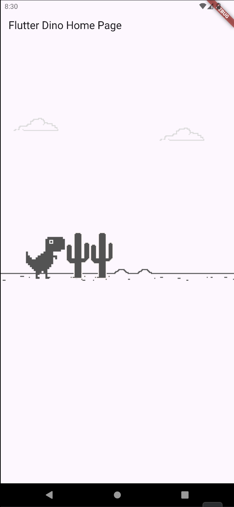
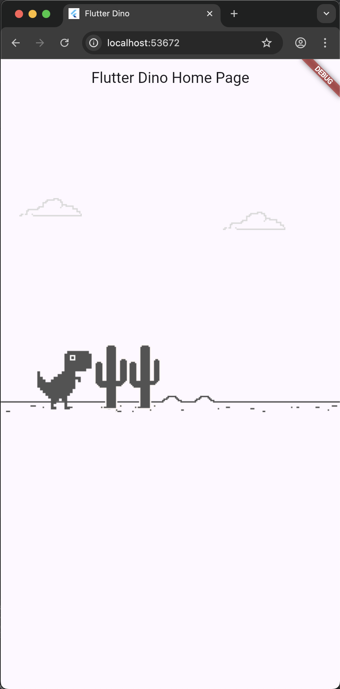
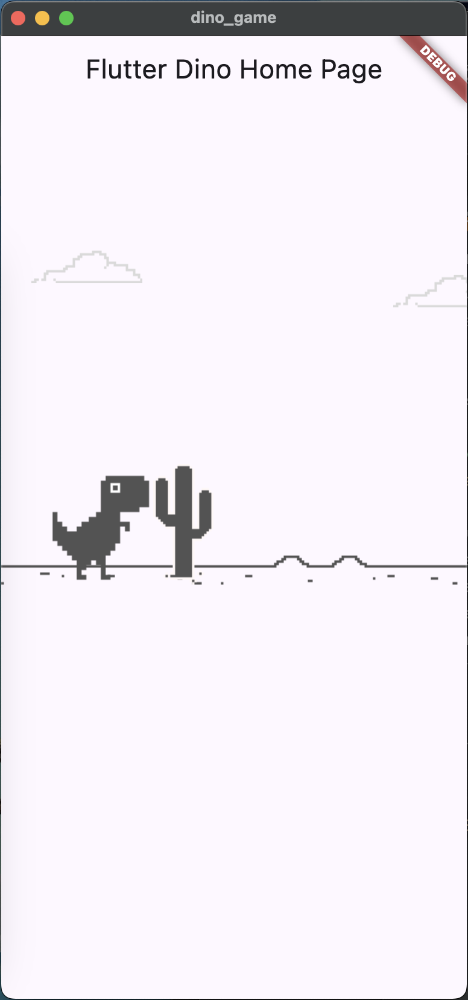
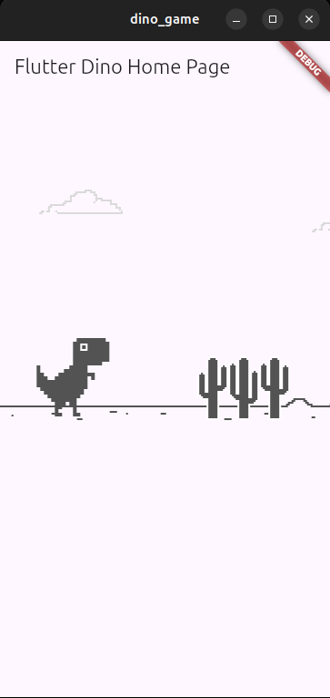

# Implementación en Flutter del Juego Dino de Chrome

Este es un repositorio de demostración que muestra cómo crear el juego Dino de Chrome con Flutter puro.

## Video

Este repositorio corresponde a este video de YouTube: https://youtu.be/YlYF1ZdFrp4

## Publicación en el Blog

Si prefieres una versión escrita, puedes consultar la publicación del blog aquí: https://www.thkp.co/blog/2020/10/19/building-the-chrome-dino-game-from-scratch-in-flutter


## (Junio 2025) Actualización a Flutter 3.29.3 y Dart 3.7.2
Repositorio bifurcado para experimentar con el juego y actualizar Flutter y Dart.

* Seguridad nula sólida
* Carpetas de plataforma regeneradas usando:
```bash
rm -rf android
flutter create .
```
* iOS: Trabajo en progreso (WIP) resolviendo problemas de compilación.

<!-- Markdown con estilo de GitHub (GFM) para forzar el tamaño de las imágenes -->
| Android | Web | MacOS | Linux (Ubuntu) |
|--------|-----|-----|-------|
|  |  |  |  |
